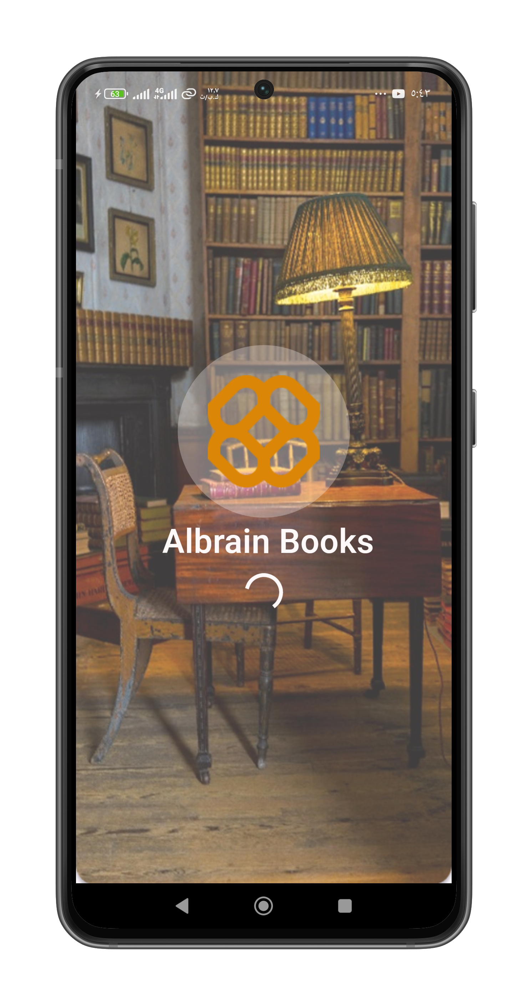
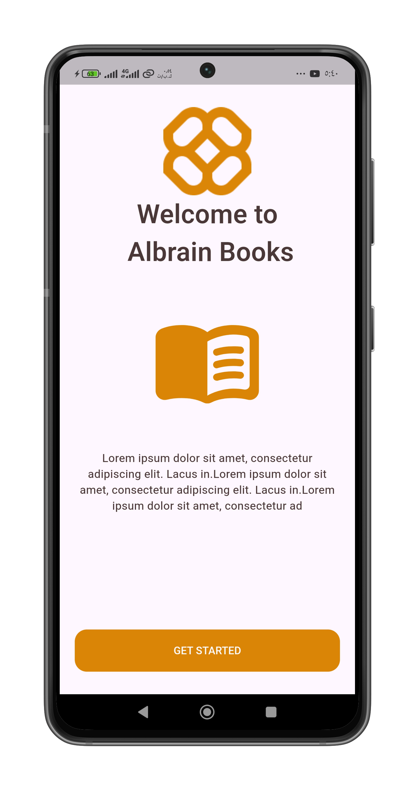
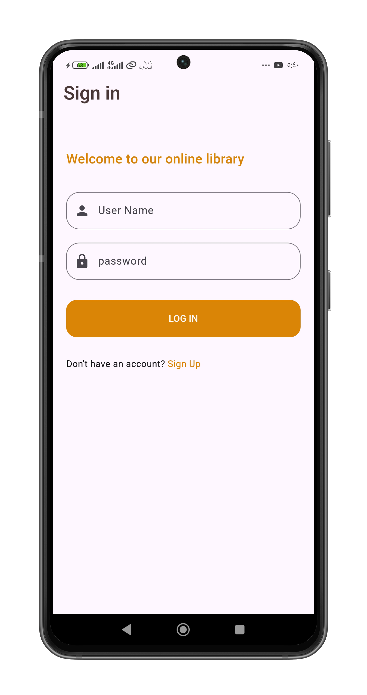
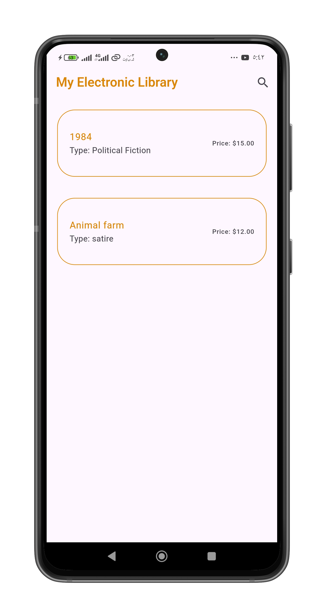
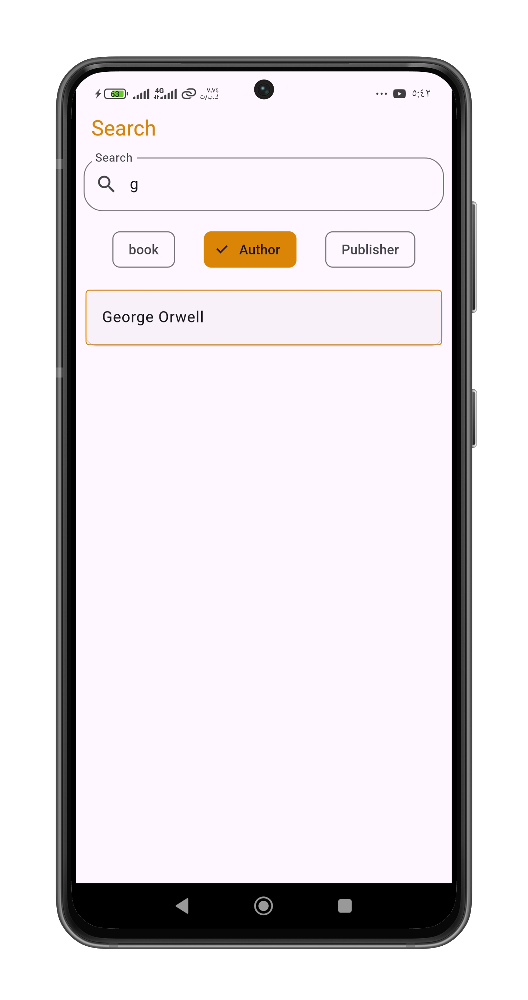
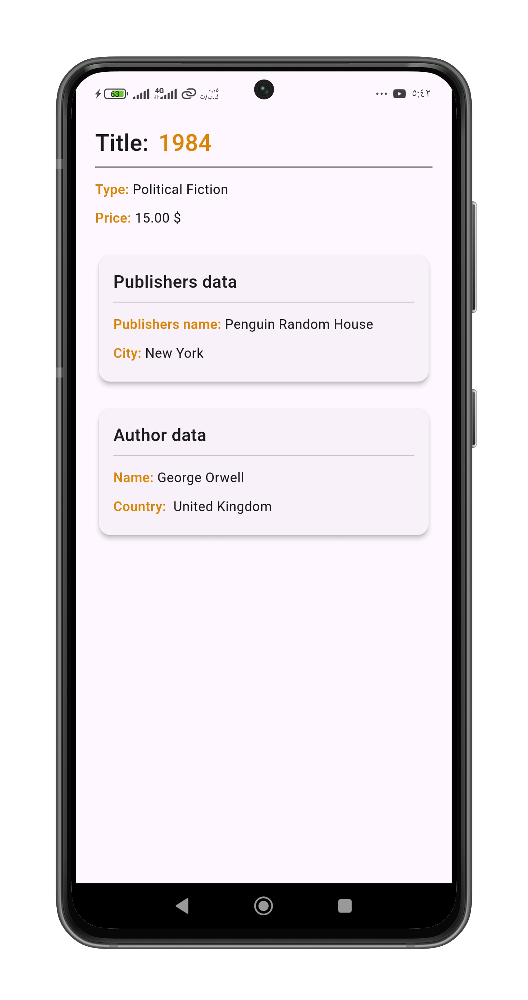
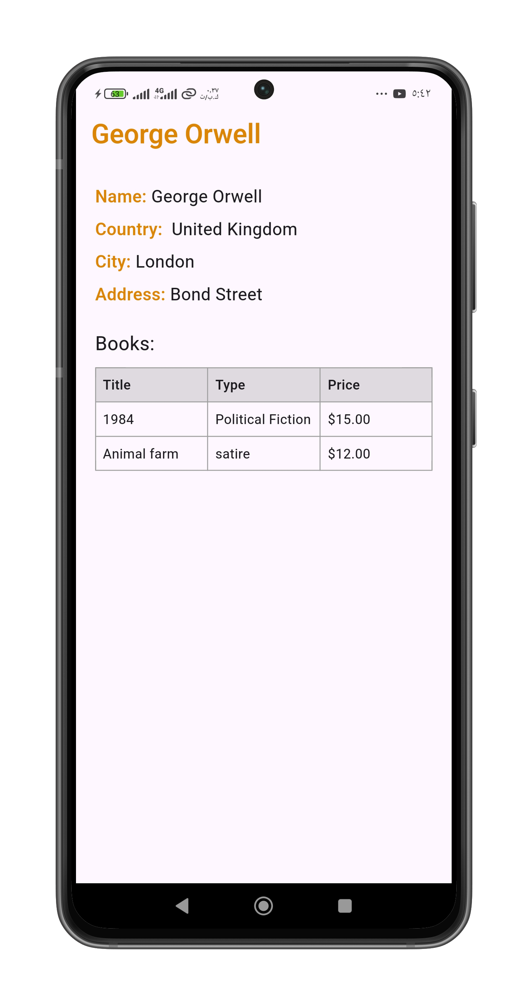
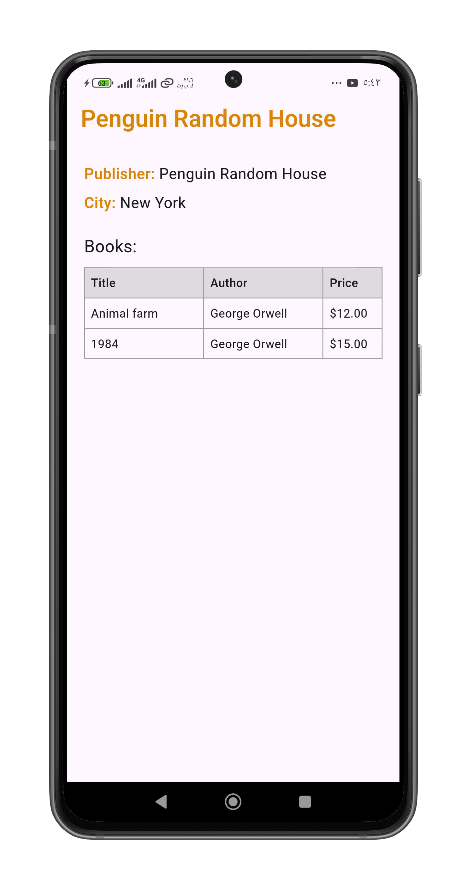

<div align="center">


# 📚 Albrain Books — Electronic Library

**A Flutter mobile app for browsing, searching, and managing an online library of books, authors, and publishers.**


</div>

---

## 📖 About

**Albrain Books** (shown in the app as *My Electronic Library*) is a client app for a library management REST API. Regular users can sign up, log in, browse the book catalog, and search by **book**, **author**, or **publisher**. Users with **administrator** privileges also get a dashboard to add new books, authors, and publishers.

## ✨ Features

- 🎬 **Splash & onboarding** – animated splash screen followed by a welcome screen.
- 🔐 **Authentication** – sign up and log in with JWT-based sessions (token stored locally with `shared_preferences`).
- 📚 **Book catalog** – list of all books with type and price.
- 🔎 **Smart search** – search by *Book*, *Author*, or *Publisher* using filter chips.
- 📄 **Details pages**
  - **Book:** title, type, price, plus its publisher and author data.
  - **Author:** name, country, city, address, and a table of their books.
  - **Publisher:** name, city, and a table of their books.
- 🛠️ **Admin panel** (admin accounts only)
  - Add a new **book** (choose author and publisher from dropdowns).
  - Add a new **author**.
  - Add a new **publisher**.
- ✅ Form validation and friendly error messages (SnackBars) for network/server failures.

## 📸 Screenshots

| Splash | Onboarding | Sign in | Sign up |
|:---:|:---:|:---:|:---:|
|  |  |  |  |

| Home | Search | Book details |
|:---:|:---:|:---:|
|  |  |  |

| Author details | Publisher details |
|:---:|:---:|
|  |  |

## 🧰 Tech Stack

| Area | Technology |
|---|---|
| Framework | [Flutter](https://flutter.dev) (Material 3) |
| Language | Dart `^3.5.4` |
| Networking | [`http`](https://pub.dev/packages/http) |
| Local storage | [`shared_preferences`](https://pub.dev/packages/shared_preferences) |
| Auth | JWT (Bearer token) |
| Linting | `flutter_lints` |

## 🗂️ Project Structure

```
lib/
├── main.dart                  # App entry point & theme
├── constant/
│   └── app_routes.dart        # Named routes
├── models/                    # Book, Author, Publisher, User
├── pages/                     # All screens (splash, onboarding, auth,
│                              #   search, details, admin forms)
├── server/
│   ├── api_config.dart        # Base URL & endpoints
│   ├── auth_service.dart      # Sign up / login / logout / token
│   ├── general_service.dart   # Public read & search endpoints
│   └── admin_service.dart     # Protected create endpoints
├── themes/
│   └── app_colors.dart        # Color palette
└── widgets/                   # Reusable button & text field
```

## 🔌 Backend API

The app expects a REST API. Endpoints used (relative to `baseUrl`):

| Method | Endpoint | Description | Auth |
|:---:|---|---|:---:|
| POST | `/auth/signup` | Create a new account | – |
| POST | `/auth/login` | Log in, returns JWT + `isAdmin` flag | – |
| GET | `/general/books` | List all books | – |
| GET | `/general/authors` | List all authors | – |
| GET | `/general/publishers` | List all publishers | – |
| GET | `/general/search/books?title=` | Search books by title | – |
| GET | `/general/search/authors?name=` | Search authors by name | – |
| GET | `/general/search/publishers?name=` | Search publishers by name | – |
| POST | `/admin/books` | Add a book | 🔒 Admin |
| POST | `/admin/authors` | Add an author | 🔒 Admin |
| POST | `/admin/publishers` | Add a publisher | 🔒 Admin |

> ⚠️ The backend is **not** part of this repository.

## 🚀 Getting Started

### Prerequisites

- [Flutter SDK](https://docs.flutter.dev/get-started/install) (Dart `^3.5.4`)
- Android Studio / VS Code with the Flutter extension
- An Android/iOS device or emulator
- The backend API running and reachable from your device

### Installation

```bash
# 1. Clone the repository
git clone https://github.com/<your-username>/<your-repo>.git
cd <your-repo>

# 2. Install dependencies
flutter pub get

# 3. Configure the API address (see below)

# 4. Run the app
flutter run
```

### ⚙️ Configuration

Set your server address in `lib/server/api_config.dart`:

```dart
static const String baseUrl = 'http://<YOUR_SERVER_IP>:5000/api';
```

- Use your computer's **local network IP** (e.g. `192.168.x.x`) when testing on a physical device.
- Use `http://10.0.2.2:5000/api` for the Android emulator.
- The phone and the server must be on the same network.

### 📦 Build

```bash
flutter build apk --release      # Android APK
flutter build appbundle          # Play Store bundle
```

## 🔑 User Roles

| Role | Capabilities |
|---|---|
| **User** | Sign up, log in, browse books, search, view details |
| **Admin** | Everything above + add books, authors, and publishers |

The role is determined by the `isAdmin` flag returned by the server at login.

## 🗺️ Roadmap

- [ ] Logout button and persistent login
- [ ] Edit / delete for books, authors, and publishers
- [ ] Move the API URL to an environment config
- [ ] Book cover images
- [ ] Dark mode
- [ ] Unit & widget tests

## 🤝 Contributing

Contributions, issues, and feature requests are welcome. Feel free to open an issue or submit a pull request.


